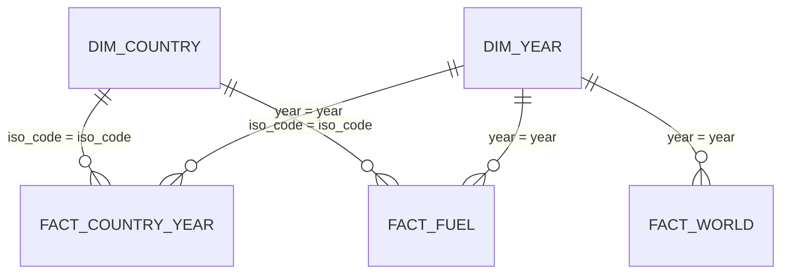

# 📊 Global CO2 Emissions: Tableau & Power BI kit

Everything needed to rebuild this project as a Power BI dashboard in under an hour: model-ready data, ready-to-paste DAX measures, a matching colour theme, a page-by-page layout, and the exact numbers your finished dashboard should show.

> **Interactive web version:** [scarface96.github.io/Global-CO2-Emissions-Dashboard](https://scarface96.github.io/Global-CO2-Emissions-Dashboard/). The kit uses the same cleaned data, so the numbers will match.

> **Tableau version:** already built, see [`Global CO2 Emissions Dashboard.twbx`](../Global%20CO2%20Emissions%20Dashboard.twbx). This kit adds the Power BI version.

## What's in this folder

| File | What it is |
|---|---|
| `data/fact_country_year.csv` | one row per country per year: CO2 (million tonnes), CO2 per person, cumulative CO2, shares of global, population, GDP |
| `data/fact_fuel.csv` | one row per country, year and fuel: CO2 from coal, oil, gas, cement, flaring and other industry |
| `data/fact_world.csv` | one row per year: world totals, including international shipping and aviation that no country owns |
| `data/dim_country.csv` | one row per country: name, ISO code, latest population |
| `powerbi/measures.dax` | Every DAX measure and calculated table, with its number format |
| `powerbi/theme.json` | Report theme in the portfolio's teal-and-amber colours |
| `kpis.json` | Headline numbers, for checking your build |
| `build_bi.py` | Regenerates everything here from the repo's own cleaning code: `python -m bi.build_bi` |

## Data model

A star schema: one fact table, small lookup tables around it, single-direction many-to-one relationships.

## Dashboard design

Canvas 1280 × 720. Light page background, white cards, teal for the main series, amber to highlight, red only for bad news.

### Page 1: The global picture
*How fast are emissions growing, and from what?*

- KPI cards (year slicer, single select, default 2021): World CO2 (Mt) · World CO2 per Person (t) · CO2 Change since 1990
- Line chart: World CO2 (Mt) by dim_year[year] from 1850
- Stacked area: Fuel CO2 (Mt) by dim_year[year], legend fact_fuel[fuel]
- Slicer: dim_year[year] range for the charts

### Page 2: Who emits
*Biggest emitters three ways*

- Filled map: dim_country[country], colour by CO2 per Person (t)
- Bar chart: top 10 dim_country[country] by CO2 (Mt) (Top N filter)
- Bar chart: top 10 by CO2 per Person (t), visual filter Population ≥ 1,000,000
- Treemap: Cumulative CO2 (Mt) by country (the historical responsibility view)

### Page 3: Change over time
*Who is cutting, and who is rising?*

- Line chart: CO2 (Mt) by year for selected countries (slicer: dim_country[country], multi-select)
- Table: country, CO2 (Mt), CO2 Change since 1990, CO2 per Person (t), conditional formatting on change
- 100% stacked bar: Fuel Share by country for the top 10 emitters

## Build it in Power BI

1. **Get data → Text/CSV** and load each file in `bi/data/`. Check that date columns come in as *Date* and IDs as *Whole number* or *Text*.
2. **Modeling → New table** for each calculated table at the top of `powerbi/measures.dax`.
3. In **Model view**, create the relationships (many-to-one, single direction): `fact_country_year[iso_code]` → `dim_country[iso_code]`; `fact_fuel[iso_code]` → `dim_country[iso_code]`; `fact_country_year[year]` → `dim_year[year]`; `fact_fuel[year]` → `dim_year[year]`; `fact_world[year]` → `dim_year[year]`.
4. **Home → Enter data**, name the table `_Measures`, load it, then add each measure from `powerbi/measures.dax` and set the format given above it.
5. **View → Themes → Browse for themes** → `powerbi/theme.json`.
6. Build the pages above. Add a title text box on each page with the question it answers.
7. Check your cards against **Check your numbers** below.
8. Save as `Global CO2 Emissions.pbix` in the repo root.

## Check your numbers

Your finished dashboard (no filters applied) should show:

| Measure | Value |
|---|---|
| Latest year | 2021 |
| World CO2 in 2021 (million tonnes) | 37,123.90 |
| World CO2 per person in 2021 (tonnes) | 4.69 |
| World cumulative CO2 to 2021 (million tonnes) | 1,736,930 |
| Largest emitter in 2021 | China (11,472.4 Mt) |
| Highest per person in 2021 (1M+ people) | Qatar (35.6 t) |
| Largest cumulative emitter | United States (421,907 Mt) |
| Countries in the model | 221 |

If a number is off, the usual causes are a relationship pointing the wrong way, a date column loaded as text, or a missing join.

## Notes on the data

- Countries don't add up to the world total: international shipping and aviation are only counted at world level. That's why world figures come from `fact_world`, not from summing countries.

## Publish and show it off

- **Power BI:** *Publish to web* needs a work or school account. Without one, add a screenshot of each page to `docs/images/` and link the `.pbix` from the README.
- Take a 1280 × 720 screenshot of page 1 and put it at the top of the main README, so it's the first thing a recruiter sees.
